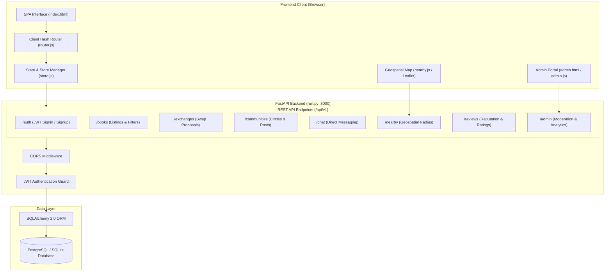

# BookLoop — Giving Books a Second Chance 📚

> **Academic Project**: B.Tech Final-Year Capstone Project  
> **Status**: Phase 12 — Final Premium Polish (Presentation-Ready Edition)  
> **Architecture**: Decoupled Client-Server (SPA + FastAPI + SQLAlchemy ORM)

---

## 1. Executive Summary & Vision

**BookLoop** is a modern, student-centric circular economy platform designed to solve textbook accessibility and campus sustainability challenges. Every semester, university students purchase expensive academic textbooks that sit unused after exams. BookLoop closes this loop by enabling students to **Buy, Sell, Exchange, Donate, and Borrow** textbooks within trusted campus communities.

### Key Objectives
- **Economic Relief**: Reduce student textbook expenditure by up to 80% through direct peer-to-peer sharing and zero middleman fees.
- **Environmental Sustainability**: Extend the lifecycle of print books, reducing paper consumption and textbook waste.
- **Campus Connectivity**: Cultivate localized academic circles and departmental book pools with privacy-preserving geolocation.
- **Safety & Trust**: Build community trust via verified student reviews, rating metrics, and administrative moderation.

---

## 2. Technology Stack & Design Decisions

| Layer | Technology | Rationale & Advantages |
| :--- | :--- | :--- |
| **Frontend Framework** | **Semantic HTML5 & Vanilla ES6+** | Zero build-step overhead, instant browser evaluation, lightweight footprint, and direct DOM control. |
| **Styling & Design System** | **Modern CSS3 (Tokens & Variables)** | Centralized design tokens in `variables.css`, fluid typography scale, dark/light themes, spring animations, glassmorphism (`backdrop-filter`). No bulky third-party CSS dependencies. |
| **Mapping & Geospatial** | **Leaflet.js + OpenStreetMap** | Open-source, lightweight interactive map with custom student markers, radius bounding, and privacy jitter. |
| **Backend API** | **FastAPI (Python 3.10+)** | High-performance asynchronous ASGI framework, native async support, automated OpenAPI (Swagger) schema generation, and strict Pydantic v2 validation. |
| **Database & ORM** | **SQLAlchemy 2.0 + SQLite / PostgreSQL** | Full ORM abstraction supporting enterprise PostgreSQL deployments and zero-configuration SQLite for testing and evaluation. |
| **Authentication & Security** | **JWT (OAuth2 Bearer) + Passlib (bcrypt)** | Stateless token-based authentication, salted bcrypt password hashing, and role-based access control (User vs Admin). |
| **Testing** | **pytest + HTTPX** | Automated test suite verifying database transactions, API contracts, authorization guards, and geospatial logic. |

---

## 3. High-Level System Architecture



---

## 4. Database Schema & Entity Relationships

The system database model consists of relational entities linked by foreign keys with cascade constraints:

1. **Users** (`users`): Identity, hashed passwords, university affiliation, avatar, privacy preferences, reputation rating, and active/suspended flags.
2. **Books / Listings** (`books`): Title, author, ISBN, category, condition (`New`, `Like New`, `Good`, `Fair`), listing type (`Sell`, `Exchange`, `Donate`, `Rent`), price, latitude/longitude, and availability status.
3. **Exchanges** (`exchanges`): Multi-stage transaction tracking between requester and owner (`Pending`, `Accepted`, `Completed`, `Rejected`, `Cancelled`).
4. **Communities** (`communities`): Campus circles and interest groups with membership counts, university filters, and active states.
5. **Community Memberships** (`community_members`): Student memberships and join dates.
6. **Community Posts & Comments** (`community_posts`, `community_comments`): Discussions, textbook requests, book sharing announcements, and peer comments.
7. **Chat Threads & Messages** (`chat_threads`, `chat_messages`): Peer-to-peer direct communication channels for coordinating book exchanges and handoffs.
8. **Reviews** (`reviews`): Peer ratings (1–5 stars), written feedback, reviewer attribution, and moderation flags.
9. **Reports & Audit Logs** (`reports`, `audit_logs`): Platform governance, violation flagging, and administrative action auditing.

---

## 5. Complete Feature Matrix (Phases 0–12)

- **Phase 0 — Project Foundations**: Project scaffolding, FastAPI runner, SQLAlchemy models, environment configuration.
- **Phase 1 — Modern Design System**: Responsive grid, CSS custom properties, fluid typography, dark/light theme switcher, animated splash screen.
- **Phase 2 — Authentication & Profile**: Secure student signup, signin, profile management, and university verification.
- **Phase 3 — Book Catalog & Discovery**: Category chips, dynamic search bar, condition filters, and book detail views.
- **Phase 4 — Book Listing Creation**: Book upload flow, image upload support, listing mode options (Sell, Swap, Donate, Rent).
- **Phase 5 — Exchange & Proposal Engine**: Proposal negotiation flow, status state machine, book lifecycle updates.
- **Phase 6 — Campus Circles & Communities**: Departmental and campus communities, discussion feeds, textbook request posts.
- **Phase 7 — Real-Time Chat & In-App Messaging**: Instant messaging between students, conversation sidebar, unread badge counters.
- **Phase 8 — Geospatial Proximity & Campus Map**: Interactive Leaflet.js map, customizable radius search (1–50 km), privacy coordinate jittering.
- **Phase 9 — Reputation, Reviews & Trust**: 5-star student review system, verified handoff ratings, impact metrics dashboard.
- **Phase 10 — Administrative Moderation Console**: Dedicated portal for user suspensions, listing moderation, community controls, and metrics.
- **Phase 11 — Integration & Testing**: End-to-end integration, regression testing, and SQLite/PostgreSQL test suite verification.
- **Phase 12 — Final Premium Polish**: Spring animations, shimmer skeletons, toast notifications, responsive refinements, and presentation documentation.

---

## 6. Installation & Setup Guide

### Prerequisites
- **Python**: Version 3.10, 3.11, or 3.12 installed
- **Git**: Installed for repository management
- Modern web browser (Chrome, Edge, Firefox, Safari)

### Step 1: Clone the Repository
```powershell
git clone https://github.com/sharmaonam4607-boop/Bookloop2.git
cd Bookloop2
```

### Step 2: Configure Environment Variables
Copy `.env.example` to `.env` in the root directory:
```powershell
cp .env.example .env
```
Default settings in `.env` are configured for instant out-of-the-box local execution.

### Step 3: Set Up Python Virtual Environment
```powershell
cd backend
python -m venv .venv
.\.venv\Scripts\Activate.ps1
```
*(On Linux/macOS, use: `source .venv/bin/activate`)*

### Step 4: Install Dependencies
```powershell
pip install -r requirements.txt
```

### Step 5: Launch the Application
```powershell
python run.py
```
The console will display:
```
INFO:     Uvicorn running on http://127.0.0.1:8000 (Press CTRL+C to quit)
INFO:     Application startup complete.
```

---

## 7. Accessing the Application

| Resource | URL | Purpose |
| :--- | :--- | :--- |
| **Main BookLoop SPA** | **http://127.0.0.1:8000/app/#/home** | Student portal (Discovery, Exchanges, Chat, Circles, Map) |
| **Admin Portal** | **http://127.0.0.1:8000/app/admin.html** | Platform moderation and operational analytics console |
| **Interactive API Docs** | **http://127.0.0.1:8000/api/v1/docs** | Swagger UI with live API testing |
| **Alternative API Docs** | **http://127.0.0.1:8000/api/v1/redoc** | Redoc technical API specification |
| **Health Check** | **http://127.0.0.1:8000/api/v1/health** | Real-time system health and database probe |

---

## 8. Interactive API Reference Summary

The backend exposes a RESTful API under `/api/v1`:

### 🔐 Authentication (`/api/v1/auth`)
- `POST /signup` — Register a new student account
- `POST /token` — Authenticate and receive a JWT Bearer token
- `GET /me` — Fetch currently authenticated student profile
- `PUT /me` — Update profile information, university, and bio

### 📖 Books & Listings (`/api/v1/books`)
- `GET /` — Browse book listings with pagination, filters, and search queries
- `POST /` — Create a new book listing
- `GET /{book_id}` — Retrieve detailed book listing information
- `PUT /{book_id}` — Edit an existing listing
- `DELETE /{book_id}` — Remove a listing

### 🔄 Exchanges & Swaps (`/api/v1/exchanges`)
- `GET /` — List user's active exchange proposals
- `POST /` — Propose an exchange or purchase for a listing
- `PUT /{id}/accept` — Accept an exchange proposal
- `PUT /{id}/reject` — Decline a proposal
- `PUT /{id}/complete` — Mark transaction as handed off and completed

### 👥 Campus Circles (`/api/v1/communities`)
- `GET /` — Discover campus communities and circles
- `POST /` — Create a new community
- `POST /{id}/join` — Join a circle
- `GET /{id}/posts` — Fetch community feed posts
- `POST /{id}/posts` — Share a post or textbook request
- `POST /{id}/posts/{post_id}/comments` — Add a comment to a discussion

### 💬 In-App Chat (`/api/v1/chat`)
- `GET /threads` — List user's active messaging threads
- `GET /threads/{thread_id}/messages` — Fetch message history
- `POST /threads/{thread_id}/messages` — Send a direct message

### 📍 Geospatial Proximity (`/api/v1/nearby`)
- `GET /` — Query books and communities within a radius (km) of given coordinates

### ⭐ Reviews & Reputation (`/api/v1/reviews`)
- `GET /user/{user_id}` — Get peer reviews and ratings for a student
- `POST /` — Submit a verified post-transaction review

### 🛡️ Administration (`/api/v1/admin`)
- `GET /analytics` — Platform operational metrics and counts
- `GET /users` — List and search registered users
- `PUT /users/{id}/toggle-status` — Suspend or reactivate student account
- `GET /listings` — Moderation view of all listings
- `GET /reports` — Review student abuse reports

---

## 9. Demonstration Flow for Examiners & Evaluators

Follow this sequence during project presentations to showcase all platform features:

1. **Brand Splash & Landing**:
   - Open `http://127.0.0.1:8000/app/#/home`.
   - Observe the splash screen, responsive hero section, and Campus Impact metrics banner.
   - Switch between **Light** and **Dark** themes using the top-bar theme toggle.

2. **Catalog Discovery & Search**:
   - Test instant search by title, author, or course code in the hero search box.
   - Click category filter chips (*Computer Science*, *Mathematics*, *Physics*, etc.).
   - Hover over book cards to preview smooth spring micro-interactions and status badges.

3. **Student Authentication & Listing**:
   - Click **Sign In / Sign Up** in the navigation header.
   - Create a test account or log in with test credentials.
   - Click **List a Book** to open the listing modal. Enter details, select listing type (Sell/Swap/Donate), and publish.

4. **Exchange & Proposal Flow**:
   - Open a book listing and click **Propose Exchange**.
   - Navigate to the **Exchanges** tab to review pending requests and simulate proposal acceptance.

5. **Campus Circles & Communities**:
   - Navigate to **Circles** (`#/communities`).
   - Browse existing department groups, join a community, and view the discussion feed.
   - Post a textbook request or comment on an existing post.

6. **Interactive Geospatial Map**:
   - Navigate to **Nearby** (`#/nearby`).
   - Adjust the radius slider (e.g., 5 km, 15 km) and update coordinates.
   - Interact with the Leaflet map pins to view localized textbook clusters.

7. **Direct Student Chat**:
   - Navigate to **Chats** (`#/chats`).
   - Open an active conversation thread and send a simulated message.

8. **Admin Operations Portal**:
   - Open `http://127.0.0.1:8000/app/admin.html`.
   - Review live platform metrics (Registered Users, Active Listings, Completed Handoffs, Open Reports).
   - Inspect user and listing moderation tables.

---

## 10. Automated Testing & Verification

The project includes an automated test suite verifying backend routers, database models, and validation logic.

To run the test suite:
```powershell
cd backend
.\.venv\Scripts\Activate.ps1
python -m pytest -v
```

All test cases run against an isolated SQLite test database with automatic fixture cleanup.

---

## 11. Project Contributors

- **Author**: B.Tech Computer Science & Engineering Final-Year Project Team
- **Institution**: University Engineering Department
- **License**: Academic Use / MIT Open Source
